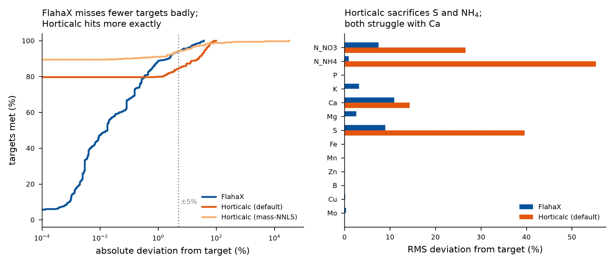
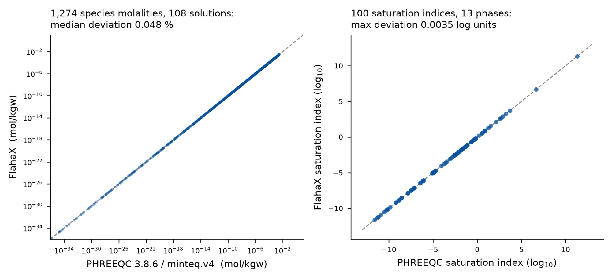

# FlahaX vs Horticalc — head-to-head on accuracy and scope

**Competitor chosen:** Horticalc (`github.com/onethree7/Horticalc`, GPL-3.0, Python) — the only
open Python tool that overlaps FlahaX on both formulation and stock-tank planning, and the
nearest neighbour identified in the novelty audit.

**Reference standards used:** PHREEQC 3.8.6 via `phreeqpython` with the USGS `minteq.v4.dat`
database (FlahaX's own cited source), and the traceable KCl conductivity standards at 25 °C.

**Test harness fairness.** Both solvers were driven programmatically with the *identical*
28-salt library (FlahaX's shipped catalogue, translated into Horticalc `Fertilizer` records) and
the *identical* 26 shipped crop formulas under two waters. Before any comparison, the translation
was validated by running 1 g/L of each of the 28 salts through both engines' forward
stoichiometry: **max relative deviation 3.1 × 10⁻¹⁴ % over 50 element comparisons** (machine
precision). Each engine's doses were then scored through one common forward model, so no
reporting-convention difference can leak into the result.

*A unit trap worth recording:* Horticalc stores the NO3/NH4/UREA columns as **elemental N**
(Haifa Cal GG, labelled 15.5 % N, is stored as NH4 0.011 + NO3 0.144). An initial translation
that treated them as molecule mass produced exactly the 4.4268×, 1.2878× and 2.1440× errors
expected. This is precisely the class of error FlahaX's explicit-units design targets.

---

## 1. Formulation accuracy — 634 element targets per engine

26 crop formulas × 2 waters (RO and 20 mg/L Ca), identical salt library, each engine's defaults.

| Statistic | FlahaX (NNLS) | Horticalc (default) | Horticalc (mass-NNLS) |
|---|---|---|---|
| element targets scored | 634 | 634 | 634 |
| **RMS deviation (%)** | **4.73** | 15.87 | 1805 |
| median absolute deviation (%) | 0.018 | **0.000** | **0.000** |
| max absolute deviation (%) | **37.4** | 98.0 | 32921 |
| RMSE (mg/L) | 12.05 | 27.30 | **7.87** |
| targets within ±5 % | **94.0 %** | 84.7 % | 94.0 % |
| targets within ±10 % | **95.6 %** | 87.2 % | 95.3 % |
| targets hit *exactly* (<0.001 %) | 11.7 % | **79.7 %** | 89.4 % |
| mean products used | 11.5 | 10.7 | 11.8 |
| mean solve time | 197 ms | **7.3 ms** | 10.5 ms |

**Read this carefully — the two engines fail differently, and neither is uniformly better.**

- Horticalc hits **79.7 %** of targets *exactly*, against FlahaX's 11.7 %. It is exact on
  P, K, Mg and every micronutrient.
- But its tail is far worse: worst miss **−98 %** (S in Generic Grow: 60 mg/L requested,
  1.22 mg/L delivered) against FlahaX's worst of −37.4 %. Its default prioritised solver
  sacrifices sulfur (RMS 39.6 %) and ammonium-N (RMS 55.3 %) to satisfy higher-tier targets.
- On **relative** error FlahaX wins decisively (4.73 % vs 15.87 % RMS). On **absolute mass**
  error Horticalc's `mass_nnls` wins (7.87 vs 12.05 mg/L) — it minimises mg/L
  squared error — but that objective is unusable in percentage terms (max 32921 %,
  because micronutrient targets overshoot enormously).
- Horticalc is **27× faster** (7.3 ms vs 197 ms per solve).
- Calcium is hard for both (RMS 10.9 % FlahaX, 14.3 % Horticalc) — a library constraint, since Ca
  enters almost exclusively through calcium nitrate and so couples to the N target.

**Caveat that favours Horticalc:** it was run at defaults with all targets at equal priority. Its
design intent is user-set Must/Important/Normal/Flexible tiers, which is exactly the mechanism
that would repair the S and NH4 misses. Removing the derived N_total objective changed little
(RMS 16.44 %), so the tails are a priority-configuration artifact, not a solver defect.

---

## 2. Aqueous equilibrium chemistry — FlahaX vs real PHREEQC

Horticalc scores **not applicable**: a grep of its complete source returns zero hits for
saturation index, speciation, ion pair, Davies, activity coefficient, precipitation or PHREEQC.
It computes stoichiometric dissolved-ion totals and an ion balance, not an equilibrium.

FlahaX was replayed independently — I wrote the PHREEQC inputs myself rather than trusting its
own test suite — across 30 catalogue products and mixtures at pH 5, 6, 7 and 8:
**108 solutions compared of 120 attempted.**

| Quantity | n | median | p95 | p99 | max |
|---|---|---|---|---|---|
| species molality, relative deviation | 1,274 | 0.0480 % | 0.835 % | 3.343 % | 6.481 % |
| ionic strength, relative deviation | 108 | 0.0017 % | 0.045 % | — | 0.093 % |
| saturation index, absolute deviation (log₁₀) | 100 | 0.00042 | 0.00224 | — | 0.00347 |

- **96.2 %** of species molalities agree within 1 %; **99.7 %** within 5 %.
- **100 %** of saturation indices agree within 0.01 log units — max deviation 0.0035.
- The largest species deviations (6.5 %) are the polynuclear molybdates Mo7O24⁻⁶ and
  HMo7O24⁻⁵ at molalities of 10⁻¹⁹ to 10⁻³⁵ — numerically irrelevant. The worst deviation on any
  species above 10⁻¹⁰ mol/kgw is 3.7 %.

**This substantiates the chemistry claim.** FlahaX's equilibrium core reproduces PHREEQC/MINTEQ.v4
to about four significant figures on an independently constructed replay.

### Verification coverage — what this test could *not* reach

| Model content | Total | Exercised against stock minteq.v4.dat |
|---|---|---|
| aqueous species | 197 | 101 distinct |
| solid phases | 28 | 13 |

Three phases — **Sylvite, Struvite, Kieserite** — are absent from stock `minteq.v4.dat`, and the
DTPA, o,o-EDDHA and urea components are FlahaX-authored (`flahax-chelates-25c.dat`,
`flahax-phases-25c.dat`). Those 12 skipped cases are not verifiable against the upstream database
by construction. Struvite in particular carries a dedicated module and public API, and its
thermodynamics rest on FlahaX's own data file.

---

## 3. Electrical conductivity — the clear loss for FlahaX

FlahaX has **no ion-based EC model**. `estimate_manufacturer_ec` is a linear sum of brochure
anchors for **7 named SQM Ultrasol products**, which the docstring itself calls a
"no-new-measurements, pre-acid screening estimate". Horticalc implements McCleskey (2012)
ion conductivity with a CRC fallback, applicable to any ion composition.

**Against traceable KCl standards at 25 °C:**

| Standard | reference µS/cm | Horticalc | error | PHREEQC | error | FlahaX |
|---|---|---|---|---|---|---|
| KCl 0.001 mol/L | 146.9 | 147.9 | +0.71 % | 146.3 | -0.42 % | not computable |
| KCl 0.01 mol/L | 1413 | 1423 | +0.74 % | 1397 | -1.13 % | not computable |
| KCl 0.1 mol/L | 12880 | 12975 | +0.74 % | 12578 | -2.34 % | not computable |

Horticalc tracks the standards to **+0.7 % across two decades of concentration**, beating
PHREEQC's own specific-conductance routine (−0.4 % to −2.3 %). FlahaX cannot be scored at all.

**On the 7 products where FlahaX does have anchors** (1 g/L, 25 °C; its brochure values treated as
the reference, since they are manufacturer measurements):

| Product | FlahaX anchor (mS/cm) | Horticalc | dev. | PHREEQC | dev. |
|---|---|---|---|---|---|
| Ultrasol K Plus | 1.30 | 1.362 | +4.8 % | 1.337 | +2.9 % |
| Ultrasol SOP | 1.50 | 1.503 | +0.2 % | 1.040 | -30.7 % |
| Ultrasol MKP | 0.70 | 0.782 | +11.7 % | 0.760 | +8.6 % |
| Ultrasol MAP | 0.90 | 0.928 | +3.2 % | 0.902 | +0.2 % |
| Ultrasol Calcium | 1.20 | 1.212 | +1.0 % | 1.205 | +0.5 % |
| Ultrasol Magsul | 1.20 | 0.880 | -26.6 % | 0.475 | -60.4 % |
| Ultrasol Magnit | 0.90 | 0.901 | +0.1 % | 0.881 | -2.1 % |

RMS deviation from the anchors: Horticalc **11.2 %**, or **5.3 %** excluding Magsul.

**One FlahaX anchor looks wrong.** For Ultrasol Magsul (MgSO4·7H2O) FlahaX carries 1.2 mS/cm at
1 g/L — and the source comment explicitly says "Magsul is 1.2, not 0.9", so the value was reviewed
deliberately. Two independent physical models disagree with it by −26.6 % (Horticalc) and −60.4 %
(PHREEQC). MgSO4 is a strongly ion-paired 2:2 electrolyte whose equivalent conductivity falls far
below an ideal estimate, so the low predictions are the physically expected direction. This single
entry dominates the RMS and is worth re-checking against the brochure.

---

## 4. Scope

| Metric | FlahaX | Horticalc |
|---|---|---|
| licence | Apache-2.0 | GPL-3.0-or-later |
| on PyPI | yes (flahax 0.4.0) | no (desktop installer / source) |
| runtime dependencies | 0 | 7 (fastapi, pydantic, numpy, scipy, uvicorn, PyYAML, pywebview) |
| library modules | 36 | 20 |
| library code lines (non-blank, non-comment) | 4417 | 4479 |
| test files | 39 | 40 |
| test functions | 162 | 326 |
| exported public API names | 80 | n/a (app-oriented; no __all__) |
| shipped products / fertilizers | 28 | 253 |
| aqueous species | 197 | 0 |
| solid phases / saturation indices | 28 | 0 |
| activity model | Davies (I<=0.1 mol/kg) | none (ionic strength used only inside EC model) |
| EC model | brochure anchors, 7 named products | McCleskey 2012 ion conductivity + CRC fallback |
| pH prediction / acid dosing | yes (equilibrium pH, nitric/phosphoric) | no (Sluijsmans acid/base equivalent only) |
| stock tank planning | yes (grouping, solubility, injector, pump) | yes (A/B/C grouping, compatibility) |
| audit record | schema+model version, input IDs | recipe hashing only |
| GUI | no (CLI only) | yes (desktop + REST API) |

---

## 5. Verdict

**Where FlahaX wins outright**
1. Equilibrium chemistry: 197 species and 28 phases, PHREEQC-accurate to ~4 significant figures. Horticalc has none.
2. pH prediction and acid dosing: present and equilibrium-based; Horticalc has only a Sluijsmans acid/base equivalent.
3. Relative formulation accuracy and worst-case robustness: RMS 4.73 % vs 15.87 %, worst miss 37 % vs 98 %.
4. Zero runtime dependencies and a genuine library API (80 exported names) against a 7-dependency desktop application.

**Where Horticalc wins outright**
1. EC: a validated ion-conductivity model accurate to +0.7 % on traceable standards, against a 7-product brochure heuristic that cannot price an arbitrary solution.
2. Exactness on well-posed targets: 79.7 % of targets hit exactly vs 11.7 %.
3. Speed: 27× faster.
4. Product library: 253 real commercial fertilizers vs 28 generic salts.
5. Test count: 326 test functions vs 162 — and a GUI plus REST API.

**The honest summary.** FlahaX is a chemistry engine with a formulation front end; Horticalc is a
formulation application with a conductivity model. The novelty claim survives this grilling on its
chemistry pillar, which is real, independently verified and absent from the competitor. It does
*not* survive on breadth of delivery-side accuracy: FlahaX's EC layer is the weakest component in
either package, and its own documentation says so.

**Three concrete actions**
1. Re-check the Ultrasol Magsul EC anchor against the brochure; two physical models say it is high by 27–60 %.
2. Either adopt McCleskey (2012) for EC — Horticalc's implementation is GPL-3.0, so a clean-room implementation from the paper is the route for an Apache-2.0 package — or drop the EC claim to an explicitly bounded screening function.
3. Publish the formulation residual statistics in this report. "94.0 % of targets within ±5 %, worst case 37 %" is a far stronger claim than "non-negative least squares", and no competitor currently publishes an equivalent number.

---

### Reproducibility

Every number above comes from code run in this session against `flahax` 0.4.0 from
a local checkout of this repository and Horticalc at branch `main` (fetched 17 Oct 2026),
with PHREEQC 3.8.6 via phreeqpython and `minteq.v4.dat` downloaded from the USGS subtree.

**Not assessed:** laboratory or field validation of either package; concentrated stock-tank
chemistry (outside the Davies range both rely on); temperature dependence away from 25 °C.
