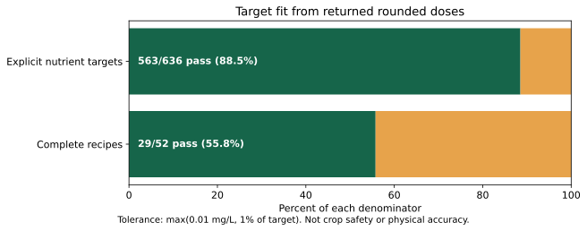
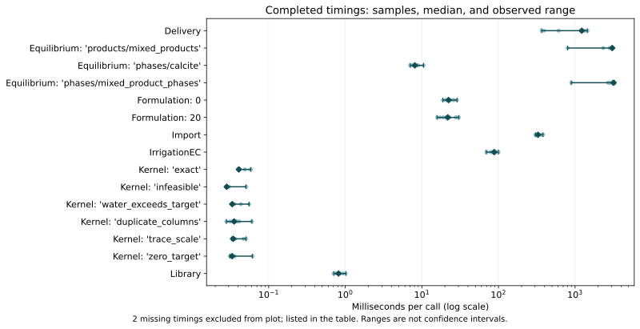

# Benchmark results: Windows

**Measured snapshot: 2026-10-20-windows-6373d23.** This page reports one clean-checkout development
baseline, including failures. It is not a release certification, a comparison
against another product, or physical validation.

```{warning}
The numerical scorecard is not fully passing: 6/7 controlled
NNLS cases pass. 2 timing workloads have no completed measurement.
The [manual GitHub benchmark workflow](https://github.com/rafatahmed/Flahax/actions/runs/39403201151) completed with conclusion
**failure**. A completed capture is not necessarily a passing
scientific scorecard; failed gates and timeouts are retained.
```

Read the [protocol and reproduction instructions](benchmark-v1.md) before comparing results.

[Results from the other recorded environment](benchmark-results.md). Treat environments separately; this is not a controlled OS comparison.

Historical Horticalc statistics in the evidence JSON are **not newly measured** and
are deliberately excluded from the charts on this page.

## What passed, and what did not

| Scorecard | Result | Meaning |
|---|---|---|
| Nutrient targets | 563/636 (88.52%) | Explicit catalogue-assay targets within max(0.01 mg/L, 1%) |
| Complete recipes | 29/52 (55.77%) | Every target passes; denominator includes attempted recipes |
| RMS target deviation | 7.330% | Percentage deviations across positive targets |
| Maximum absolute target deviation | 100.000% | Largest percentage miss across positive targets |
| Nutrient RMSE | 13.278 mg/L | Absolute concentration residuals across explicit targets |
| Stored chemistry comparisons | 21/21 | Quantity-specific agreement with stored PHREEQC captures |
| Controlled NNLS problems | 6/7 | Identical matrices/objectives compared with pinned SciPy |
| Completed timing workloads | 15/17 | Parameterized timings, with failures retained |
| Physical validation | Not performed | No measured mixture/pH/titration/EC accuracy claim |



Formula targets are desired inputs, not proof of agronomic suitability.
Reconstruction uses returned rounded doses and declared assays; unassayed
counterions are outside this scorecard. Missing targets are not scored.
Percentage statistics exclude zero targets; absolute residual metrics retain them.
There were 0 formulation exceptions; their
element rows are excluded, while attempted recipes remain in the recipe denominator.

## Timing and memory



Dots are samples; diamonds are medians; bars show the observed minimum–maximum.
These are single-machine, single-run observations, **not confidence intervals or
an established estimate of between-run variation**. Ten samples do not establish
a stable tail-latency estimate. No blocking speed thresholds are proposed.
Setup and correctness checks are outside timed calls; process timeout budgets
include repeated setup. Fresh-process import includes interpreter startup and
does not establish a cold filesystem cache.

| Workload / parameter | Samples | Median (ms) | Observed range (ms) |
|---|---:|---:|---|
| Delivery | 10 | 1223 | 366–1449 |
| Equilibrium: 'products/mixed_products' | 10 | 3054 | 799.4–3134 |
| Equilibrium: 'phases/calcite' | 10 | 8.106 | 7.056–10.53 |
| Equilibrium: 'phases/mixed_product_phases' | 10 | 3171 | 892.6–3305 |
| Equilibrium: 'products/mixed_target_ph_nitric' | 0 | — | Missing; see limitations and ASV log |
| Formulation: 0 | 10 | 22.34 | 18.83–28.78 |
| Formulation: 20 | 10 | 21.8 | 15.8–30.44 |
| Import | 10 | 328.6 | 303.5–382.4 |
| IrrigationEC | 10 | 88.03 | 69.53–100.1 |
| Kernel: 'exact' | 10 | 0.04085 | 0.0397–0.0584 |
| Kernel: 'infeasible' | 10 | 0.0283 | 0.0277–0.0507 |
| Kernel: 'water_exceeds_target' | 10 | 0.0334 | 0.0328–0.0556 |
| Kernel: 'duplicate_columns' | 10 | 0.03535 | 0.028–0.0604 |
| Kernel: 'near_dependent' | 0 | — | Missing; see limitations and ASV log |
| Kernel: 'trace_scale' | 10 | 0.03445 | 0.0329–0.0506 |
| Kernel: 'zero_target' | 10 | 0.0333 | 0.0312–0.0615 |
| Library | 10 | 0.8168 | 0.707–1.016 |

Peak memory is total process peak RSS, including the interpreter and setup,
not the incremental allocation of the solver. Decimal MB are used.

| Workload / parameter | Peak process memory (MB) |
|---|---:|
| Equilibrium: 'products/mixed_products' | 36.80 |
| Equilibrium: 'phases/calcite' | 36.64 |
| Equilibrium: 'phases/mixed_product_phases' | 36.94 |
| Equilibrium: 'products/mixed_target_ph_nitric' | 37.15 |
| Formulation: 0 | 36.95 |
| Formulation: 20 | 36.84 |

## Retained limitations

- `near_dependent`: objective gap 1.5e-12; tolerance 1e-12.

See [NNLS investigation #36](https://github.com/rafatahmed/Flahax/issues/36).
No solver tolerance was loosened to produce a passing score.

Missing timings are not zero-duration or successful calculations. The ASV log
in the evidence bundle records each failure. The acid workload's 900-second
budget includes repeated warm/setup solves; a timeout does not mean that one
solve takes 900 seconds or fails chemistry checks.
See [measurement-budget issue #37](https://github.com/rafatahmed/Flahax/issues/37).

Stored PHREEQC agreement shares thermodynamic data and is not independent
experimental validation. This benchmark command did not run live PHREEQC.
Prescribed-pH fixtures do not independently test calculated-pH accuracy.
Experimental EC is a regression check, not measured conductivity validation.
Recipe misses need [per-case analysis #39](https://github.com/rafatahmed/Flahax/issues/39).
The [follow-up tracker](https://github.com/rafatahmed/Flahax/issues/42) also covers
aligned competitor comparisons and physical validation.

## Provenance and reproduction

The normal [CI run](https://github.com/rafatahmed/Flahax/actions/runs/39401426949) for this exact revision is recorded separately
from these performance measurements. Its jobs are shown below; this is **not**
the manual benchmark workflow. In particular, the hosted live-PHREEQC job is
separate evidence and its results are not counted as benchmark cases.

| Hosted check | Recorded conclusion |
|---|---|
| [docs](https://github.com/rafatahmed/Flahax/actions/runs/39401426949/job/118556812006) | success |
| [test (3.11)](https://github.com/rafatahmed/Flahax/actions/runs/39401426949/job/118556812325) | success |
| [test (3.13)](https://github.com/rafatahmed/Flahax/actions/runs/39401426949/job/118556812394) | success |
| [phreeqc-live](https://github.com/rafatahmed/Flahax/actions/runs/39401426949/job/118556812408) | success |
| [test (3.12)](https://github.com/rafatahmed/Flahax/actions/runs/39401426949/job/118556812540) | success |


## Capture notes

These timings were collected locally on Windows/Python 3.13.15 from clean commit 6373d23. The earlier dirty Python 3.14 measurements are not reused here.

The hosted manual workflow attempt at this same revision completed its scientific scorecard but could not start ASV timings because the fresh runner lacked a local main branch. That setup failure is retained in hosted-workflow.log; it is distinct from the local timing results below. The Linux results page uses a later revision with the ASV default changed to HEAD. Do not pool these environments or interpret differences as an OS performance comparison.

The local regression log records 21 tests run, with one documentation-build check skipped because no HTML had yet been built in the clean checkout. Hosted correctness and documentation checks for this exact revision passed separately.

This Windows capture records a platform CPU label and logical CPU count, but its custom ASV machine label omitted the full CPU/RAM inventory. Those missing fields remain explicit. The corrected hosted workflow captures the complete automatic machine inventory.


## Recorded environment

| Field | Recorded value |
|---|---|
| Source revision | [6373d2345408](https://github.com/rafatahmed/Flahax/commit/6373d23454080852504dbdad9fc0ecff2089550b) |
| Checkout | Clean before and after measurement |
| Capture started (UTC) | 2026-10-20T09:28:24.164021+00:00 |
| Capture finished (UTC) | 2026-10-20T09:56:29.155366+00:00 |
| Python | 3.13.15 (tags/v3.13.15:4061bc4, Aug  5 2026, 13:05:39) [MSC v.1944 64 bit (AMD64)] |
| OS / architecture | Windows-11-10.0.26200-SP0 / AMD64 |
| Processor (ASV model or platform label) | Intel64 Family 6 Model 140 Stepping 1, GenuineIntel |
| Logical CPUs | 8 |
| RAM (ASV bytes) | Not recorded |
| Direct benchmark tooling | asv 0.6.6, scipy 1.18.1, numpy 2.5.4, asv-runner 0.3.2 |
| Input manifest SHA-256 | `338f21d664f7627807527cdf551c9bd56741c33c644e6ed2a82d010c9cf47460` |

Input manifests match before and after. They cover runtime/model/catalogue data,
benchmark sources, tracked example helpers, stored reference captures, the historical
CSV, package configuration and workflow. The bundle includes resolved environment
versions, regression-test output, ASV configuration metadata and raw samples.
The documentation renderer is separate from the measured commit; its exact source
and pinned plotting requirement are included in the evidence bundle.

Reproduce in a clean checkout of the linked revision using Python 3.13 and the
[protocol's commands](benchmark-v1.md). Keep all exit statuses, even on failure.
Charts can be regenerated with `tools/publish_benchmark_report.py`; see its CLI
help and `tools/requirements-benchmark-report.txt`.

From the publication checkout, use the unchanged measured checkout as `CLEAN`
and a new lowercase snapshot identifier as `NEW_SNAPSHOT`:

```console
python -m pip install -r tools/requirements-benchmark-report.txt
python -m tools.publish_benchmark_report --capture CLEAN/build/benchmark-v1 --asv-results CLEAN/build/asv/results --source-checkout CLEAN --site docs/site --snapshot NEW_SNAPSHOT
```

The renderer refuses to overwrite a snapshot and verifies every recorded input
against the measured checkout before publishing files.

## Download the evidence

- [Complete evidence ZIP](../_static/benchmarks/2026-10-20-windows-6373d23/evidence.zip) — scorecards, before/after metadata,
  raw ASV records and logs, environment, CSVs, charts and renderer source.
- [Machine-readable combined report](../_static/benchmarks/2026-10-20-windows-6373d23/baseline.json)
- [Per-target formulation CSV](../_static/benchmarks/2026-10-20-windows-6373d23/formulation.csv)
- [Timing summary CSV](../_static/benchmarks/2026-10-20-windows-6373d23/timings.csv)
- [SHA-256 checksums of bundle contents](../_static/benchmarks/2026-10-20-windows-6373d23/CHECKSUMS.sha256)
- Chart downloads: [target fit PNG](../_static/benchmarks/2026-10-20-windows-6373d23/formulation.png), [timing PNG](../_static/benchmarks/2026-10-20-windows-6373d23/timings.png).

ZIP SHA-256: `bea535736c4b6b8ec7ed4eaf43f8ebba0cf960acb881b336b036c9daac99dfc9`.

User-home identifiers in paths were replaced for public redistribution.
Numerical values and source/input hashes are unchanged. Checksums refer to the
redistributed files; the archive explains the path-only redaction.

:::{dropdown} All recipe cases
| Case | Targets passing | Whole recipe |
|---|---:|---|
| cmbpfud0y006wq8z9ghn6t86g:zero_nutrients | 11/12 | Miss |
| cmbpfud0y006wq8z9ghn6t86g:calcium_20_mg_l | 11/12 | Miss |
| cmbpfud9f00eaq8z92ve3zic0:zero_nutrients | 10/12 | Miss |
| cmbpfud9f00eaq8z92ve3zic0:calcium_20_mg_l | 11/12 | Miss |
| cmbpfucsg0002q8z9a5q0u7nu:zero_nutrients | 12/12 | Pass |
| cmbpfucsg0002q8z9a5q0u7nu:calcium_20_mg_l | 12/12 | Pass |
| cmbpfud6y00c1q8z9emlc27x2:zero_nutrients | 12/12 | Pass |
| cmbpfud6y00c1q8z9emlc27x2:calcium_20_mg_l | 12/12 | Pass |
| cmbpfudcu00haq8z9xwjoq1zt:zero_nutrients | 11/13 | Miss |
| cmbpfudcu00haq8z9xwjoq1zt:calcium_20_mg_l | 13/13 | Pass |
| cmbpfud7r00crq8z9qc0abr6h:zero_nutrients | 7/12 | Miss |
| cmbpfud7r00crq8z9qc0abr6h:calcium_20_mg_l | 7/12 | Miss |
| cmbpfudbu00giq8z9jquzw746:zero_nutrients | 9/13 | Miss |
| cmbpfudbu00giq8z9jquzw746:calcium_20_mg_l | 13/13 | Pass |
| cmbpfucvl002kq8z9in7tpn5y:zero_nutrients | 12/12 | Pass |
| cmbpfucvl002kq8z9in7tpn5y:calcium_20_mg_l | 12/12 | Pass |
| cmbpfucun001uq8z9dgqeihsj:zero_nutrients | 12/12 | Pass |
| cmbpfucun001uq8z9dgqeihsj:calcium_20_mg_l | 12/12 | Pass |
| cmbpfud8k00dhq8z9yz59ziwb:zero_nutrients | 13/13 | Pass |
| cmbpfud8k00dhq8z9yz59ziwb:calcium_20_mg_l | 13/13 | Pass |
| cmbpfuddo00i2q8z9nldrxm9w:zero_nutrients | 13/13 | Pass |
| cmbpfuddo00i2q8z9nldrxm9w:calcium_20_mg_l | 13/13 | Pass |
| cmbpfud2n008cq8z99v63xpo5:zero_nutrients | 12/12 | Pass |
| cmbpfud2n008cq8z99v63xpo5:calcium_20_mg_l | 12/12 | Pass |
| cmbpfudb100fqq8z9wcljgmyi:zero_nutrients | 7/13 | Miss |
| cmbpfudb100fqq8z9wcljgmyi:calcium_20_mg_l | 7/13 | Miss |
| cmbpfud3e0092q8z9vq8gw25x:zero_nutrients | 11/13 | Miss |
| cmbpfud3e0092q8z9vq8gw25x:calcium_20_mg_l | 11/13 | Miss |
| cmbpfuctq0014q8z9li5oo75d:zero_nutrients | 7/12 | Miss |
| cmbpfuctq0014q8z9li5oo75d:calcium_20_mg_l | 7/12 | Miss |
| cmbpfudel00iuq8z9l2wiwsfy:zero_nutrients | 12/12 | Pass |
| cmbpfudel00iuq8z9l2wiwsfy:calcium_20_mg_l | 12/12 | Pass |
| cmbpfuda900f0q8z9hi9hu2gu:zero_nutrients | 11/12 | Miss |
| cmbpfuda900f0q8z9hi9hu2gu:calcium_20_mg_l | 12/12 | Pass |
| cmbpfud6400bbq8z9gwrj4cw7:zero_nutrients | 12/12 | Pass |
| cmbpfud6400bbq8z9gwrj4cw7:calcium_20_mg_l | 12/12 | Pass |
| cmbpfud5900alq8z907fk2r92:zero_nutrients | 12/12 | Pass |
| cmbpfud5900alq8z907fk2r92:calcium_20_mg_l | 12/12 | Pass |
| cmbpfud4a009vq8z953niqg47:zero_nutrients | 10/12 | Miss |
| cmbpfud4a009vq8z953niqg47:calcium_20_mg_l | 10/12 | Miss |
| cmbpfucxi0040q8z94o3m2bps:zero_nutrients | 12/12 | Pass |
| cmbpfucxi0040q8z94o3m2bps:calcium_20_mg_l | 12/12 | Pass |
| cmbpfucz7005gq8z90ev9h6ao:zero_nutrients | 8/12 | Miss |
| cmbpfucz7005gq8z90ev9h6ao:calcium_20_mg_l | 8/12 | Miss |
| cmbpfucyc004qq8z9mdajrg3w:zero_nutrients | 8/12 | Miss |
| cmbpfucyc004qq8z9mdajrg3w:calcium_20_mg_l | 12/12 | Pass |
| cmbpfud030066q8z9fvdyru1m:zero_nutrients | 8/12 | Miss |
| cmbpfud030066q8z9fvdyru1m:calcium_20_mg_l | 8/12 | Miss |
| cmbpfucwh003aq8z9vmh9kner:zero_nutrients | 12/12 | Pass |
| cmbpfucwh003aq8z9vmh9kner:calcium_20_mg_l | 12/12 | Pass |
| cmbpfud1t007mq8z9w16hx6hw:zero_nutrients | 12/12 | Pass |
| cmbpfud1t007mq8z9w16hx6hw:calcium_20_mg_l | 11/12 | Miss |
:::
