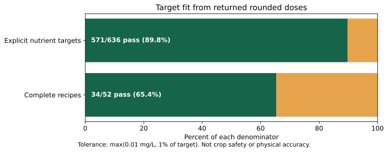
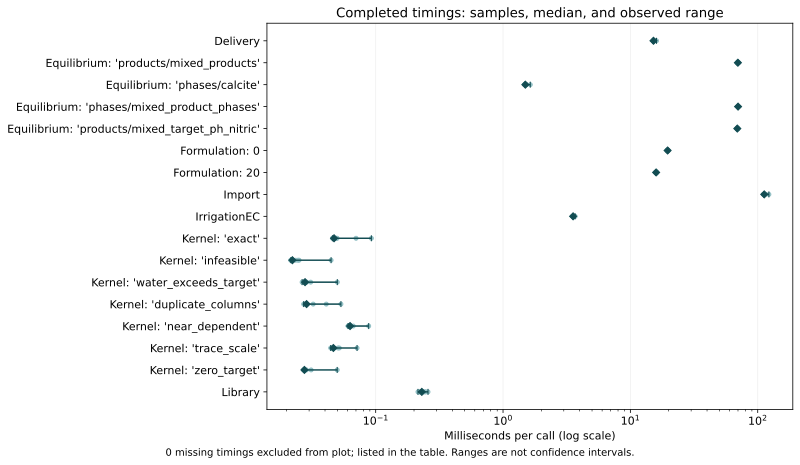

# Benchmark results: Linux

**Measured snapshot: 2026-10-20-linux-df0d30b.** This page reports one clean-checkout development
baseline, including failures. It is not a release certification, a comparison
against another product, or physical validation.

```{note}
Every correctness gate passed: 7/7 controlled NNLS cases, 21/21
stored chemistry comparisons, and every timing workload completed. The [manual GitHub benchmark workflow](https://github.com/rafatahmed/Flahax/actions/runs/39515183621) completed with conclusion **success**.
Formulation target misses below are reported results, not gate failures. Passing
pull-request CI checks are separate evidence.
```

Read the [protocol and reproduction instructions](benchmark-v1.md) before comparing results.

[Results from the other recorded environment](benchmark-results-windows.md). Treat environments separately; this is not a controlled OS comparison.

:::{toctree}
:hidden:

benchmark-results-windows
:::

Historical Horticalc statistics in the evidence JSON are **not newly measured** and
are deliberately excluded from the charts on this page.

## What passed, and what did not

| Scorecard | Result | Meaning |
|---|---|---|
| Nutrient targets | 571/636 (89.78%) | Explicit catalogue-assay targets within max(0.01 mg/L, 1%) |
| Complete recipes | 34/52 (65.38%) | Every target passes; denominator includes attempted recipes |
| RMS target deviation | 7.384% | Percentage deviations across positive targets |
| Maximum absolute target deviation | 100.000% | Largest percentage miss across positive targets |
| Nutrient RMSE | 13.260 mg/L | Absolute concentration residuals across explicit targets |
| Stored chemistry comparisons | 21/21 | Quantity-specific agreement with stored PHREEQC captures |
| Controlled NNLS problems | 7/7 | Identical matrices/objectives compared with pinned SciPy |
| Completed timing workloads | 17/17 | Parameterized timings, with failures retained |
| Physical validation | Not performed | No measured mixture/pH/titration/EC accuracy claim |



Formula targets are desired inputs, not proof of agronomic suitability.
Reconstruction uses returned rounded doses and declared assays; unassayed
counterions are outside this scorecard. Missing targets are not scored.
Percentage statistics exclude zero targets; absolute residual metrics retain them.
There were 0 formulation exceptions; their
element rows are excluded, while attempted recipes remain in the recipe denominator.

### Where targets were missed

The largest miss is Si in Rice (Douglas Peckenpaugh), zero nutrients (`cmbpfud3e0092q8z9vq8gw25x:zero_nutrients`): target 100 mg/L, delivered 0 mg/L (-100.0%).

| Nutrient | Failing targets |
|---|---:|
| Ca | 16/52 |
| N_NO3 | 16/52 |
| S | 12/52 |
| Mg | 11/52 |
| K | 6/52 |
| N_NH4 | 2/10 |
| Si | 2/2 |

Per-case causes are tracked in [recipe-fit analysis #39](https://github.com/rafatahmed/Flahax/issues/39).

## Timing and memory



Dots are samples; diamonds are medians; bars show the observed minimum–maximum.
These are single-machine, single-run observations, **not confidence intervals or
an established estimate of between-run variation**. Ten samples do not establish
a stable tail-latency estimate. No blocking speed thresholds are proposed.
Setup and correctness checks are outside timed calls; process timeout budgets
include repeated setup. Fresh-process import includes interpreter startup and
does not establish a cold filesystem cache.

| Workload / parameter | Samples | Median (ms) | Observed range (ms) |
|---|---:|---:|---|
| Delivery | 10 | 15.19 | 15.03–16.04 |
| Equilibrium: 'products/mixed_products' | 10 | 69.87 | 69.02–70.61 |
| Equilibrium: 'phases/calcite' | 10 | 1.497 | 1.48–1.637 |
| Equilibrium: 'phases/mixed_product_phases' | 10 | 70.08 | 69.89–70.25 |
| Equilibrium: 'products/mixed_target_ph_nitric' | 10 | 69.14 | 68.75–69.59 |
| Formulation: 0 | 10 | 19.6 | 19.52–19.78 |
| Formulation: 20 | 10 | 15.93 | 15.74–16.12 |
| Import | 10 | 112.5 | 111.2–122.4 |
| IrrigationEC | 10 | 3.55 | 3.526–3.687 |
| Kernel: 'exact' | 10 | 0.04711 | 0.04573–0.09249 |
| Kernel: 'infeasible' | 10 | 0.02218 | 0.02156–0.04464 |
| Kernel: 'water_exceeds_target' | 10 | 0.02788 | 0.02644–0.04996 |
| Kernel: 'duplicate_columns' | 10 | 0.02867 | 0.02718–0.05334 |
| Kernel: 'near_dependent' | 10 | 0.06292 | 0.06074–0.0881 |
| Kernel: 'trace_scale' | 10 | 0.04653 | 0.04431–0.07141 |
| Kernel: 'zero_target' | 10 | 0.02756 | 0.02719–0.04987 |
| Library | 10 | 0.2303 | 0.2147–0.2576 |

Peak memory is total process peak RSS, including the interpreter and setup,
not the incremental allocation of the solver. Decimal MB are used.
Only 6 workloads have a memory
benchmark; the other workloads are timed only.

| Workload / parameter | Peak process memory (MB) |
|---|---:|
| Equilibrium: 'products/mixed_products' | 39.92 |
| Equilibrium: 'phases/calcite' | 39.98 |
| Equilibrium: 'phases/mixed_product_phases' | 40.11 |
| Equilibrium: 'products/mixed_target_ph_nitric' | 39.97 |
| Formulation: 0 | 40.03 |
| Formulation: 20 | 40.00 |

## Retained limitations

- None in this capture.

See [NNLS investigation #36](https://github.com/rafatahmed/Flahax/issues/36).
No solver tolerance was loosened to produce a passing score.

Missing timings are not zero-duration or successful calculations. The ASV log
in the evidence bundle records each failure. The acid workload's 900-second
budget includes repeated warm/setup solves; a timeout does not mean that one
solve takes 900 seconds or fails chemistry checks.
See [measurement-budget issue #37](https://github.com/rafatahmed/Flahax/issues/37).

Stored PHREEQC agreement shares thermodynamic data and is not independent
experimental validation. This benchmark command did not run live PHREEQC.
Prescribed-pH fixtures do not independently test calculated-pH accuracy.
Experimental EC is a regression check, not measured conductivity validation.
Recipe misses need [per-case analysis #39](https://github.com/rafatahmed/Flahax/issues/39).
The [follow-up tracker](https://github.com/rafatahmed/Flahax/issues/42) also covers
aligned competitor comparisons and physical validation.

## Provenance and reproduction

The normal [CI run](https://github.com/rafatahmed/Flahax/actions/runs/39515081885) for this exact revision is recorded separately
from these performance measurements. Its jobs are shown below; this is **not**
the manual benchmark workflow. In particular, the hosted live-PHREEQC job is
separate evidence and its results are not counted as benchmark cases.

| Hosted check | Recorded conclusion |
|---|---|
| [phreeqc-live](https://github.com/rafatahmed/Flahax/actions/runs/39515081885/job/118945185616) | success |
| [test (3.13)](https://github.com/rafatahmed/Flahax/actions/runs/39515081885/job/118945185755) | success |
| [docs](https://github.com/rafatahmed/Flahax/actions/runs/39515081885/job/118945185773) | success |
| [test (3.12)](https://github.com/rafatahmed/Flahax/actions/runs/39515081885/job/118945185877) | success |
| [test (3.11)](https://github.com/rafatahmed/Flahax/actions/runs/39515081885/job/118945185910) | success |


## Capture notes

This hosted Linux capture measured clean revision df0d30bf4f62365056e0b0f250c75d0cf7206611, after the equilibrium solver speed-up (#61, PR #62), the ASV discovery fix (#64, PR #65) and the ceiling-constraint and NNLS optimality fix (#68, PR #69). The manual workflow completed with conclusion success: all correctness scorecards and all ASV workloads. Earlier captures are not substituted for this one: 61dda094c39ccd8810e63db63794f9e984c29cd6 (run 39510611814) measured no timings because ASV discovery failed (#64), and 4dffdf864ed4d52b44705cb89b43ad1afa659ef3 (run 39511463809) predates #69. The Windows supplement still refers to revision 6373d23454080852504dbdad9fc0ecff2089550b and was not re-measured; do not pool environments. Hosted runner CPUs vary between runs; compare timings only within one capture. Normal CI for this revision is separate evidence.


## Recorded environment

| Field | Recorded value |
|---|---|
| Source revision | [df0d30bf4f62](https://github.com/rafatahmed/Flahax/commit/df0d30bf4f62365056e0b0f250c75d0cf7206611) |
| Checkout | Clean before and after measurement |
| Capture started (UTC) | 2026-10-20T23:28:16.452120+00:00 |
| Capture finished (UTC) | 2026-10-20T23:28:40.245151+00:00 |
| Python | 3.13.16 (main, Oct  1 2026, 02:37:54) [GCC 13.3.0] |
| OS / architecture | Linux-6.17.0-1022-azure-x86_64-with-glibc2.39 / x86_64 |
| Processor (ASV model or platform label) | AMD EPYC 7763 64-Core Processor |
| Logical CPUs | 4 |
| RAM (ASV bytes) | 16766414848 |
| Direct benchmark tooling | asv 0.6.6, scipy 1.18.1, numpy 2.5.4, asv-runner 0.3.2 |
| Input manifest SHA-256 | `b25dc7d73e372e8ea5e4290404df37aac86aeeee4ecadaa6975d5f68c0680fe7` |

Input manifests match before and after. They cover runtime/model/catalogue data,
benchmark sources, tracked example helpers, stored reference captures, the historical
CSV, package configuration and workflow. The bundle includes resolved environment
versions, regression-test output, ASV configuration metadata and raw samples.
The documentation renderer is separate from the measured commit; its exact source
and pinned plotting requirement are included in the evidence bundle.

Reproduce in a clean checkout of the linked revision using Python 3.13 and the
[protocol's commands](benchmark-v1.md). Keep all exit statuses, even on failure.
Charts can be regenerated with `tools/publish_benchmark_report.py`; see its CLI
help and `tools/requirements-benchmark-report.txt`.

From the publication checkout, use the unchanged measured checkout as `CLEAN`
and a new lowercase snapshot identifier as `NEW_SNAPSHOT`:

```console
python -m pip install -r tools/requirements-benchmark-report.txt
python -m tools.publish_benchmark_report --capture CLEAN/build/benchmark-v1 --asv-results CLEAN/build/asv/results --source-checkout CLEAN --site docs/site --snapshot NEW_SNAPSHOT
```

The renderer refuses to overwrite a snapshot and verifies every recorded input
against the measured checkout before publishing files.

## Download the evidence

- [Complete evidence ZIP](../_static/benchmarks/2026-10-20-linux-df0d30b/evidence.zip) — scorecards, before/after metadata,
  raw ASV records and logs, environment, CSVs, charts and renderer source.
- [Machine-readable combined report](../_static/benchmarks/2026-10-20-linux-df0d30b/baseline.json)
- [Per-target formulation CSV](../_static/benchmarks/2026-10-20-linux-df0d30b/formulation.csv)
- [Timing summary CSV](../_static/benchmarks/2026-10-20-linux-df0d30b/timings.csv)
- [SHA-256 checksums of bundle contents](../_static/benchmarks/2026-10-20-linux-df0d30b/CHECKSUMS.sha256)
- Chart downloads: [target fit PNG](../_static/benchmarks/2026-10-20-linux-df0d30b/formulation.png), [timing PNG](../_static/benchmarks/2026-10-20-linux-df0d30b/timings.png).

ZIP SHA-256: `650e3e90a34ee3bc44b5e1d4abef09e802de0ec50ded9c4a72c7d9de76b21cb2`.

User-home identifiers in paths were replaced for public redistribution.
Numerical values and source/input hashes are unchanged. Checksums refer to the
redistributed files; the archive explains the path-only redaction.

:::{dropdown} All recipe cases
| Case | Targets passing | Whole recipe |
|---|---:|---|
| Chilli (maximumyield), zero nutrients (`cmbpfud0y006wq8z9ghn6t86g:zero_nutrients`) | 12/12 | Pass |
| Chilli (maximumyield), calcium 20 mg l (`cmbpfud0y006wq8z9ghn6t86g:calcium_20_mg_l`) | 12/12 | Pass |
| Cucumber (Howard Resh), zero nutrients (`cmbpfud9f00eaq8z92ve3zic0:zero_nutrients`) | 10/12 | Miss |
| Cucumber (Howard Resh), calcium 20 mg l (`cmbpfud9f00eaq8z92ve3zic0:calcium_20_mg_l`) | 12/12 | Pass |
| DEFAULT, zero nutrients (`cmbpfucsg0002q8z9a5q0u7nu:zero_nutrients`) | 12/12 | Pass |
| DEFAULT, calcium 20 mg l (`cmbpfucsg0002q8z9a5q0u7nu:calcium_20_mg_l`) | 12/12 | Pass |
| Generic Bloom (maximumyield), zero nutrients (`cmbpfud6y00c1q8z9emlc27x2:zero_nutrients`) | 12/12 | Pass |
| Generic Bloom (maximumyield), calcium 20 mg l (`cmbpfud6y00c1q8z9emlc27x2:calcium_20_mg_l`) | 12/12 | Pass |
| Generic Dry Season (Howard Resh), zero nutrients (`cmbpfudcu00haq8z9xwjoq1zt:zero_nutrients`) | 11/13 | Miss |
| Generic Dry Season (Howard Resh), calcium 20 mg l (`cmbpfudcu00haq8z9xwjoq1zt:calcium_20_mg_l`) | 13/13 | Pass |
| Generic Grow (maximumyield), zero nutrients (`cmbpfud7r00crq8z9qc0abr6h:zero_nutrients`) | 8/12 | Miss |
| Generic Grow (maximumyield), calcium 20 mg l (`cmbpfud7r00crq8z9qc0abr6h:calcium_20_mg_l`) | 7/12 | Miss |
| Generic Wet Season (Howard Resh), zero nutrients (`cmbpfudbu00giq8z9jquzw746:zero_nutrients`) | 9/13 | Miss |
| Generic Wet Season (Howard Resh), calcium 20 mg l (`cmbpfudbu00giq8z9jquzw746:calcium_20_mg_l`) | 13/13 | Pass |
| Generic for Berries (Growing Edge), zero nutrients (`cmbpfucvl002kq8z9in7tpn5y:zero_nutrients`) | 12/12 | Pass |
| Generic for Berries (Growing Edge), calcium 20 mg l (`cmbpfucvl002kq8z9in7tpn5y:calcium_20_mg_l`) | 12/12 | Pass |
| Hoagland solution, zero nutrients (`cmbpfucun001uq8z9dgqeihsj:zero_nutrients`) | 12/12 | Pass |
| Hoagland solution, calcium 20 mg l (`cmbpfucun001uq8z9dgqeihsj:calcium_20_mg_l`) | 12/12 | Pass |
| Lettuce 2 (Howard Resh), zero nutrients (`cmbpfud8k00dhq8z9yz59ziwb:zero_nutrients`) | 13/13 | Pass |
| Lettuce 2 (Howard Resh), calcium 20 mg l (`cmbpfud8k00dhq8z9yz59ziwb:calcium_20_mg_l`) | 13/13 | Pass |
| Lettuce General (Howard Resh), zero nutrients (`cmbpfuddo00i2q8z9nldrxm9w:zero_nutrients`) | 13/13 | Pass |
| Lettuce General (Howard Resh), calcium 20 mg l (`cmbpfuddo00i2q8z9nldrxm9w:calcium_20_mg_l`) | 13/13 | Pass |
| Melons (Douglas Peckenpaugh), zero nutrients (`cmbpfud2n008cq8z99v63xpo5:zero_nutrients`) | 12/12 | Pass |
| Melons (Douglas Peckenpaugh), calcium 20 mg l (`cmbpfud2n008cq8z99v63xpo5:calcium_20_mg_l`) | 12/12 | Pass |
| Pepper (Howard Resh), zero nutrients (`cmbpfudb100fqq8z9wcljgmyi:zero_nutrients`) | 7/13 | Miss |
| Pepper (Howard Resh), calcium 20 mg l (`cmbpfudb100fqq8z9wcljgmyi:calcium_20_mg_l`) | 7/13 | Miss |
| Rice (Douglas Peckenpaugh), zero nutrients (`cmbpfud3e0092q8z9vq8gw25x:zero_nutrients`) | 12/13 | Miss |
| Rice (Douglas Peckenpaugh), calcium 20 mg l (`cmbpfud3e0092q8z9vq8gw25x:calcium_20_mg_l`) | 12/13 | Miss |
| Strawberry Drip Irrigation (schundler.com), zero nutrients (`cmbpfuctq0014q8z9li5oo75d:zero_nutrients`) | 7/12 | Miss |
| Strawberry Drip Irrigation (schundler.com), calcium 20 mg l (`cmbpfuctq0014q8z9li5oo75d:calcium_20_mg_l`) | 7/12 | Miss |
| Strawberry Fruiting (growing edge), zero nutrients (`cmbpfudel00iuq8z9l2wiwsfy:zero_nutrients`) | 12/12 | Pass |
| Strawberry Fruiting (growing edge), calcium 20 mg l (`cmbpfudel00iuq8z9l2wiwsfy:calcium_20_mg_l`) | 12/12 | Pass |
| Tomato (Howard Resh), zero nutrients (`cmbpfuda900f0q8z9hi9hu2gu:zero_nutrients`) | 12/12 | Pass |
| Tomato (Howard Resh), calcium 20 mg l (`cmbpfuda900f0q8z9hi9hu2gu:calcium_20_mg_l`) | 12/12 | Pass |
| Tomato Stage.1 - 10-14 days (Howard Resh), zero nutrients (`cmbpfud6400bbq8z9gwrj4cw7:zero_nutrients`) | 12/12 | Pass |
| Tomato Stage.1 - 10-14 days (Howard Resh), calcium 20 mg l (`cmbpfud6400bbq8z9gwrj4cw7:calcium_20_mg_l`) | 12/12 | Pass |
| Tomato Stage.2 - first cluster (Howard Resh), zero nutrients (`cmbpfud5900alq8z907fk2r92:zero_nutrients`) | 12/12 | Pass |
| Tomato Stage.2 - first cluster (Howard Resh), calcium 20 mg l (`cmbpfud5900alq8z907fk2r92:calcium_20_mg_l`) | 12/12 | Pass |
| Tomato Stage.3 - to plant maturity (Howard Resh), zero nutrients (`cmbpfud4a009vq8z953niqg47:zero_nutrients`) | 10/12 | Miss |
| Tomato Stage.3 - to plant maturity (Howard Resh), calcium 20 mg l (`cmbpfud4a009vq8z953niqg47:calcium_20_mg_l`) | 10/12 | Miss |
| Tomatoes - Fourth Cluster (U of Florida), zero nutrients (`cmbpfucxi0040q8z94o3m2bps:zero_nutrients`) | 12/12 | Pass |
| Tomatoes - Fourth Cluster (U of Florida), calcium 20 mg l (`cmbpfucxi0040q8z94o3m2bps:calcium_20_mg_l`) | 12/12 | Pass |
| Tomatoes - Second Cluster (U of Florida), zero nutrients (`cmbpfucz7005gq8z90ev9h6ao:zero_nutrients`) | 8/12 | Miss |
| Tomatoes - Second Cluster (U of Florida), calcium 20 mg l (`cmbpfucz7005gq8z90ev9h6ao:calcium_20_mg_l`) | 8/12 | Miss |
| Tomatoes - Third Cluster (U of Florida), zero nutrients (`cmbpfucyc004qq8z9mdajrg3w:zero_nutrients`) | 8/12 | Miss |
| Tomatoes - Third Cluster (U of Florida), calcium 20 mg l (`cmbpfucyc004qq8z9mdajrg3w:calcium_20_mg_l`) | 12/12 | Pass |
| Tomatoes - till First Cluster (U of Florida), zero nutrients (`cmbpfud030066q8z9fvdyru1m:zero_nutrients`) | 8/12 | Miss |
| Tomatoes - till First Cluster (U of Florida), calcium 20 mg l (`cmbpfud030066q8z9fvdyru1m:calcium_20_mg_l`) | 8/12 | Miss |
| Tomatoes - to termination (U of Florida), zero nutrients (`cmbpfucwh003aq8z9vmh9kner:zero_nutrients`) | 12/12 | Pass |
| Tomatoes - to termination (U of Florida), calcium 20 mg l (`cmbpfucwh003aq8z9vmh9kner:calcium_20_mg_l`) | 12/12 | Pass |
| Tropical Lettuce (Douglas Peckenpaugh), zero nutrients (`cmbpfud1t007mq8z9w16hx6hw:zero_nutrients`) | 12/12 | Pass |
| Tropical Lettuce (Douglas Peckenpaugh), calcium 20 mg l (`cmbpfud1t007mq8z9w16hx6hw:calcium_20_mg_l`) | 12/12 | Pass |
:::
