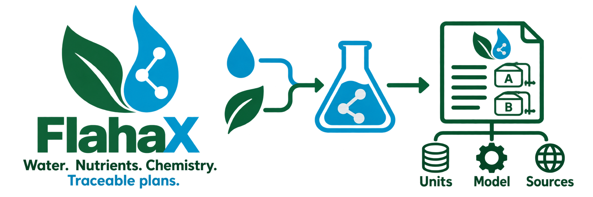

# FlahaX

```{raw} html
<div class="flahax-brand-banner">
  
  
</div>
```

```{rst-class} flahax-hero
```

**Plant-nutrient chemistry engine in Python: fertilizer formulation, aqueous
equilibrium chemistry and auditable delivery planning.**

FlahaX turns a crop's nutrient formula and the grower's actual water into a
fertilizer recipe, then checks what that recipe does in solution: which ions
pair up, whether anything precipitates, what the pH will be, how much acid
reaches a target pH, and how the recipe splits into stock tanks and injector
flows. Every plan carries its units, model identifiers and source hashes, so
a result can be reviewed and reproduced.

```{raw} html
<div class="flahax-badges"><span>Python 3.11+</span><span>No runtime dependencies</span><span>Checked against PHREEQC 3.8.6</span><span>Computational evidence only</span></div>
```

## Start here

::::{grid} 1 2 2 2
:gutter: 3

:::{grid-item-card} Get started
:link: guide/usage
:link-type: doc

Install FlahaX and run a first recipe from Python or the command line.
:::

:::{grid-item-card} Growers and agronomists
:link: growers
:link-type: doc

What FlahaX gives you and how to read a plan, in plain words.
:::

:::{grid-item-card} User manual
:link: guide/manual
:link-type: doc

The full workflow from water analysis to stock tanks, pH and EC.
:::

:::{grid-item-card} API reference
:link: api/reference
:link-type: doc

Every public function, its inputs, outputs and contract.
:::

:::{grid-item-card} Models and chemistry
:link: models/method
:link-type: doc

The equilibrium model, its coverage and the PHREEQC reference fixtures.
:::

:::{grid-item-card} Evidence and audits
:link: evidence/release-evidence
:link-type: doc

Release evidence, the owner's computational assessment, and audit reports
with their scope and review status.
:::
::::

## What sets it apart

- **Verified against PHREEQC.** Every catalogue product, phase and acid case
  is replayed live against pinned PHREEQC 3.8.6 (USGS).
- **Traceable materials.** Material identity, grade, lot and nutrient band
  are carried through the calculation.
- **Every result with its source and stated limit.** Explicit units, model
  identifiers, source hashes and `needs_input` instead of guessed values.
  Plans are reviewable records, not operating authorizations.

FlahaX has no third-party runtime dependencies. The evidence is
computational: it has not been validated in the laboratory or in the field.

## Install

```bash
python -m pip install flahax
```

## Quick start

Select salts for a crop formula, with 20 mg/L of calcium already in the water:

```python
from flahax import load_library, recommend

result = recommend(
    load_library()["salts"],
    targets={"N_NO3": 128, "P": 58, "K": 211, "Ca": 104, "Mg": 40, "S": 54},
    water={"Ca": 20},
)

for salt in result["salts"]:
    print(f"{salt['name']}: {salt['gramsPerLitre']} g/L")
```

```{toctree}
:caption: Get started
:hidden:

Install and first steps <guide/usage>
```

```{toctree}
:caption: Growers and agronomists
:hidden:

For growers and agronomists <growers>
```

```{toctree}
:caption: User manual
:hidden:

User manual <guide/manual>
```

```{toctree}
:caption: API reference
:hidden:

Public API <api/reference>
```

```{toctree}
:caption: Models and chemistry
:hidden:

Method <models/method>
Fertilizer equilibrium model <models/fertilizer-equilibrium-model>
Equilibrium kernel <models/equilibrium-kernel>
Full fertilizer chemistry <models/full-fertilizer-chemistry>
Chemistry coverage matrix <models/chemistry-coverage-matrix>
PHREEQC reference fixtures <models/reference-fixtures>
Chelate extension (25 °C) <models/flahax-chelate-thermodynamic-profile>
```

```{toctree}
:caption: Evidence and audits
:hidden:

Release evidence <evidence/release-evidence>
Computational assessment <evidence/computational-review>
Package verification <api/package-verification>
Planning validation history <evidence/planning-validation-history>
Fertilizer source review <guide/source-sheet-review>
Audits <evidence/audit/README>
FlahaX vs Horticalc audit <evidence/audit/2026-10-17-flahax-vs-horticalc/report>
Horticalc audit review <evidence/audit/2026-10-17-flahax-vs-horticalc/review>
Materials identity audit review <evidence/audit/2026-10-18-materials-identity/review>
```

```{toctree}
:caption: Changelog
:hidden:

Changelog <changelog>
```
