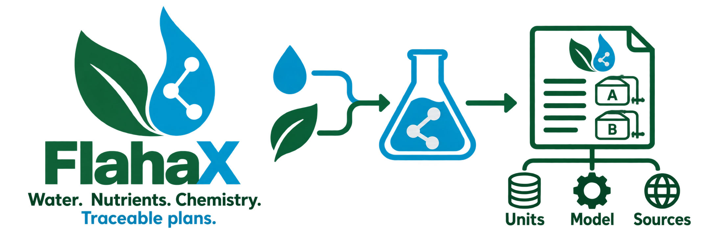

# FlahaX

```{raw} html
<div class="flahax-brand-banner">
  
  
</div>
```

```{rst-class} flahax-hero
```

**Plant-nutrient chemistry engine in Python: fertilizer formulation, aqueous equilibrium
chemistry and auditable delivery planning.**

Growers and agronomists need a practical batch recipe from crop-feed targets, source-water
analyses and available fertilizers. Water nutrients, pH-reagent contributions, product
composition and dispensing uncertainty affect the finished feed.

FlahaX formulates candidate recipes, reports achieved nutrients and modeled chemistry, and
produces traceable preparation quantities for review. Supply targets directly or use Sonneveld
target design with approved feed corrections from root-zone observations. Evaluate declared
fertilizer alternatives, then check rounded dry, separate-stock and reagent doses under the
specified uncertainty and limits.

The grower or agronomist makes the feed and preparation decisions using the calculated results,
their qualifications and the required measurements.

```{mermaid}
---
caption: From your water to your tanks
---
flowchart LR
    W[Water analysis] --> R[Recipe<br/>grams of each fertilizer]
    F[Supplied or Sonneveld-designed<br/>finished-feed targets] --> R
    P[Fertilizers you have] --> R
    R --> H[pH plan<br/>acid or base to the target]
    T[Target pH] --> H
    H --> K[Tank assignment<br/>or rounded batch preparation]
    K --> S[Batch sheet and report<br/>review and measure after mixing]
```

## Choose your path

::::{grid} 1 1 3 3
:gutter: 3

:::{grid-item-card} Grower
:link: grower/index
:link-type: doc

Use the `flahax mix` interview or review an agronomist-prepared Sonneveld profile. Read the
selected quantities, preparation checks and notes, then record measurements after mixing.
:::

:::{grid-item-card} Agronomist
:link: agronomist/index
:link-type: doc

Enter lab analyses, build formulas, define products from labels and data sheets, plan pH, and
read the nutrient table and review notes.
:::

:::{grid-item-card} Developer and researcher
:link: developer/index
:link-type: doc

Use the Python API, the equilibrium chemistry and the planning contracts; reproduce the evidence
and contribute.
:::
::::

## Install

```bash
python -m pip install flahax
```

Python 3.11 or newer, with no third-party runtime dependencies. See [Install](start/install.md) for
upgrading and checking your version.

## Status and limits

FlahaX is in Beta. Its chemistry is checked against PHREEQC 3.8.6 (USGS), but it has not been
validated in the laboratory or in the field: results are calculations for planning, not dosing
instructions. Measure pH and EC after mixing. See [Scope and limits](explanation/scope-and-limits.md).

```{toctree}
:caption: Get started
:hidden:

Install <start/install>
Your first batch <start/first-batch>
Your first recipe in Python <start/first-recipe>
Migrate saved workflows <start/migration>
```

```{toctree}
:caption: Grower guide
:hidden:

Overview <grower/index>
What you need <grower/inputs>
Run a batch <grower/run-a-batch>
Review a Sonneveld batch <grower/sonneveld-walkthrough>
Read the batch sheet <grower/batch-sheet>
Mix safely <grower/mix-safely>
```

```{toctree}
:caption: Agronomist guide
:hidden:

Overview <agronomist/index>
A batch from files <agronomist/batch-command>
Sonneveld Appendix I <agronomist/sonneveld-appendix-i>
Formulas and products <agronomist/formula-and-products>
pH, acids and bases <agronomist/ph-and-acids>
Tanks and solubility <agronomist/tanks-and-solubility>
Solubility qualification <agronomist/solubility-qualification>
Condition-qualified stock assignments <agronomist/stock-assignments>
Reading the results <agronomist/reading-results>
```

```{toctree}
:caption: Developer and researcher guide
:hidden:

Overview <developer/index>
Python API in practice <developer/python-api>
Water, targets and acids <developer/water-to-delivery>
Site planning <developer/site-planning>
Conductivity <developer/conductivity>
Delivery contracts <developer/delivery-contracts>
Delivery quantities <developer/delivery-quantities>
Joint fertilizer/reagent problem <developer/joint-problem>
Verification <developer/verification>
Contributing <developer/contributing>
```

```{toctree}
:caption: Reference
:hidden:

Command line <reference/cli>
Python API <reference/api>
Input files <reference/file-formats>
Error codes <reference/errors>
Reading plans and results <reference/reading-plans>
User manual (offline) <reference/manual>
```

```{toctree}
:caption: Explanation
:hidden:

How a recipe is calculated <explanation/how-a-recipe-is-calculated>
Why FlahaX needs your water's pH <explanation/water-and-ph>
Scope and limits <explanation/scope-and-limits>
Method <models/method>
Fertilizer equilibrium model <models/fertilizer-equilibrium-model>
Equilibrium kernel <models/equilibrium-kernel>
Full fertilizer chemistry <models/full-fertilizer-chemistry>
Material masses and evidence status <models/material-mass-convention>
Material inventory before fitting <models/material-inventory>
Concentration and solvent mass <models/concentration-basis>
Total alkalinity and carbon inference <models/total-alkalinity>
Reaction qualification and domains <models/reaction-qualification>
Chemistry coverage matrix <models/chemistry-coverage-matrix>
PHREEQC reference fixtures <models/reference-fixtures>
Chelate extension (25 °C) <models/flahax-chelate-thermodynamic-profile>
```

```{toctree}
:caption: Evidence
:hidden:

Release evidence <evidence/release-evidence>
Benchmark specification and reproduction <evidence/benchmark-v1>
Benchmark results and downloads <evidence/benchmark-results>
Competitor comparison <evidence/competitor-comparison>
Computational assessment <evidence/computational-review>
Physical validation protocol (draft) <evidence/physical-validation-protocol>
Planning validation history <evidence/planning-validation-history>
Fertilizer source review <evidence/source-sheet-review>
Audits <evidence/audit/README>
FlahaX vs Horticalc audit <evidence/audit/2026-10-17-flahax-vs-horticalc/report>
Horticalc audit review <evidence/audit/2026-10-17-flahax-vs-horticalc/review>
Materials identity audit review <evidence/audit/2026-10-18-materials-identity/review>
```

```{toctree}
:caption: Project
:hidden:

Changelog <changelog>
Release notes <project/releases>
Citation <project/citation>
License and credits <project/license>
Security <project/security>
Code of conduct <project/code-of-conduct>
Roadmap <project/roadmap>
```
